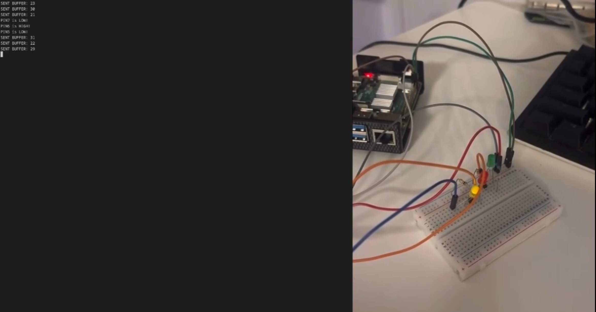
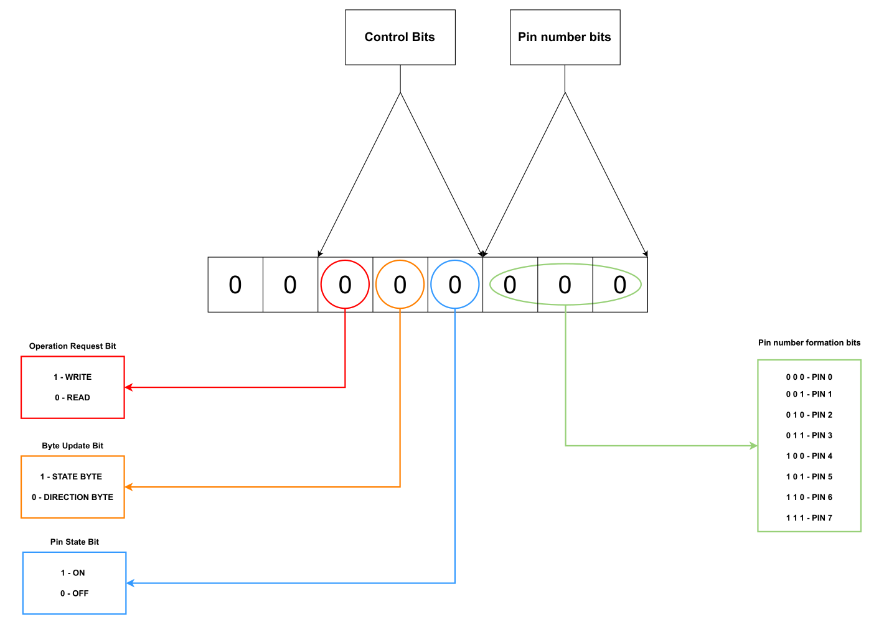
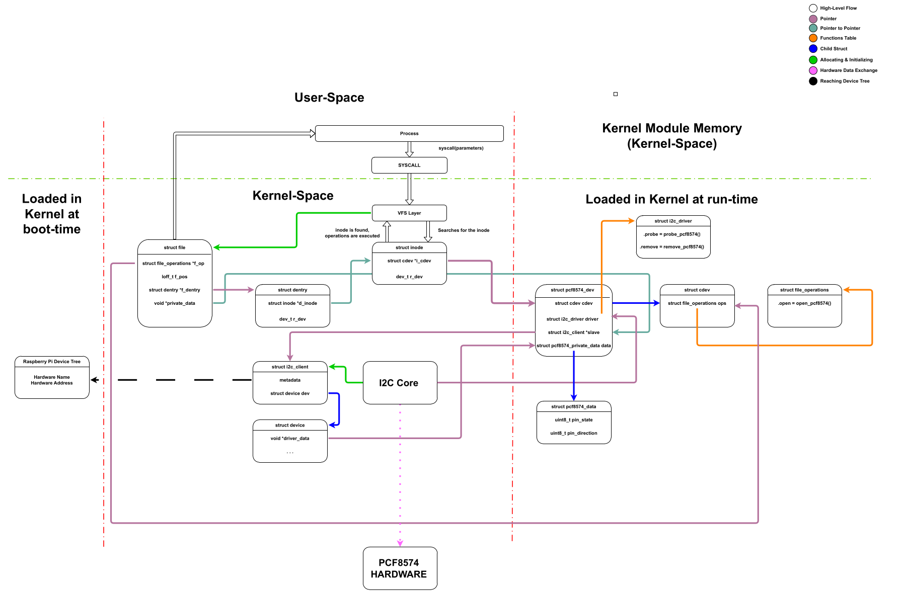

# Photo


# Goals
- Create a cdev driver
- Integrate it with the i2c subsystem
- Update the devicetree, so the kernel can connect the module to the device 
- Make the device controllable from userland programs   

# Features
- Update state of pins
- Read state of pins
- Turn every pin ON/OFF with a single function call

# Communication mechanism

- The binary protocol is an agreement between the library and the kernel module. The userland process is abstracted away from it by functions like setPin() readPin().

# Device Driver Data Flow

- An illustration of how the pcf8574 and the device driver fits into the bigger picture.   
# Development Notes
- For research purposes, the dev node is created manually.
   
# Compilation
- The compilation currently is tested only on Fedora
- The selected versions are the ones that are known to work. Earlier versions might work as well, but that's not guaranteed.

Requirements
- Kernel Version
    - Linux 6.14+
- Compiler
    - GCC 15.3+        
- Build Automation Tool
    - Make 4.4+
- Kernel Build Files
    - Same version as the target's kernel

- Missing Components
    1) If any of the last 3 requirements is missing:
        ```bash
        sudo dnf install kernel-devel gcc make
        ```
        To check the kernel build directory for the running kernel:
        ```bash
        ls -l /lib/modules/$(uname -r)/build
        ```

# Compilation

1. From the project root, run:
    ```bash
    make
    ```

# Adding the new functionality to the kernel

1. Load the kernel module
    ```bash
    sudo insmod pcf8574.ko 
    ```
2. Once loaded, the major number has to be determined. One way to do that is by checking the kernel log

    ```bash
    sudo dmesg -l warn
    ```
    Look at the message. "Major is {NUMBER}". This is important for the next step.

3. Finally, a dev node has to be created manually. This is done by calling the following command:

    ```bash
    sudo mknod /dev/pcf8574 c {NUMBER} 0 
    ```
    Note: {NUMBER} has to be replaced by the Major number  